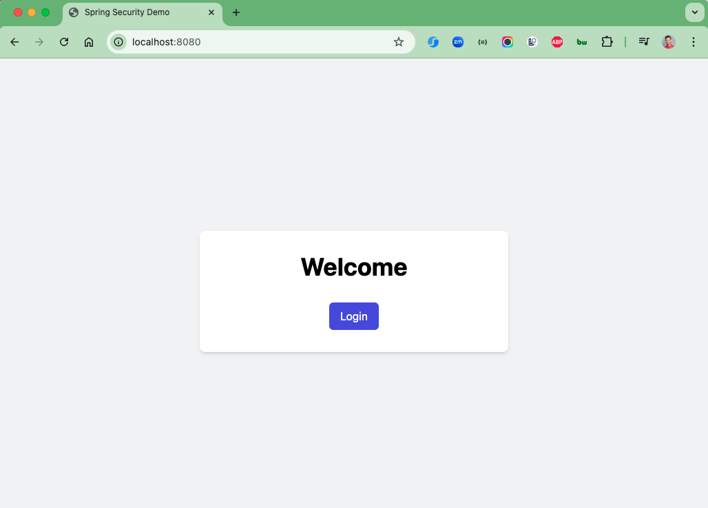
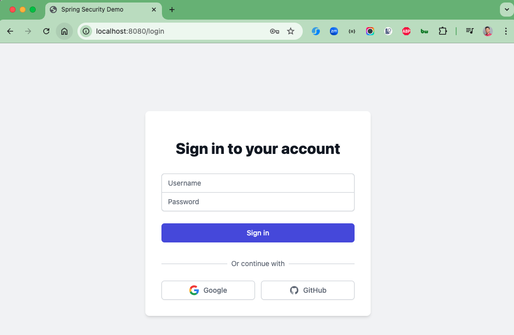
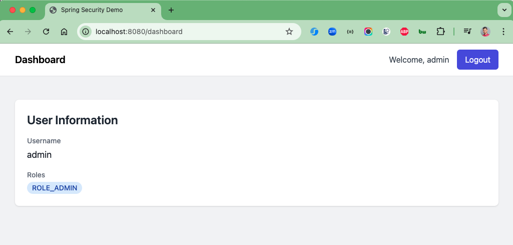
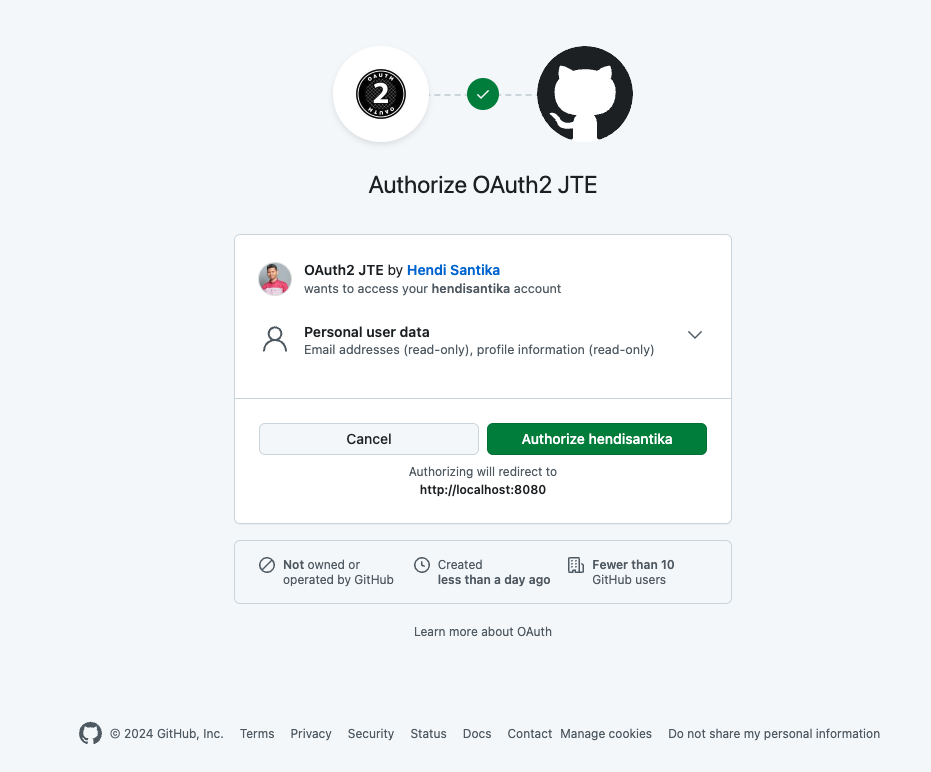
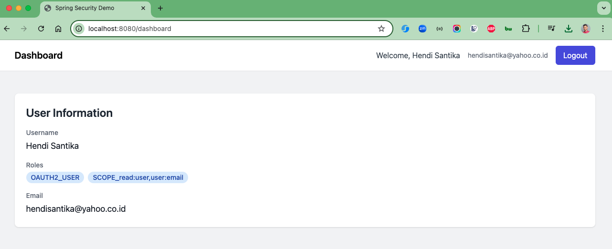
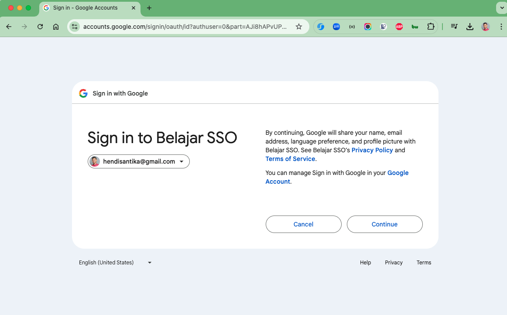
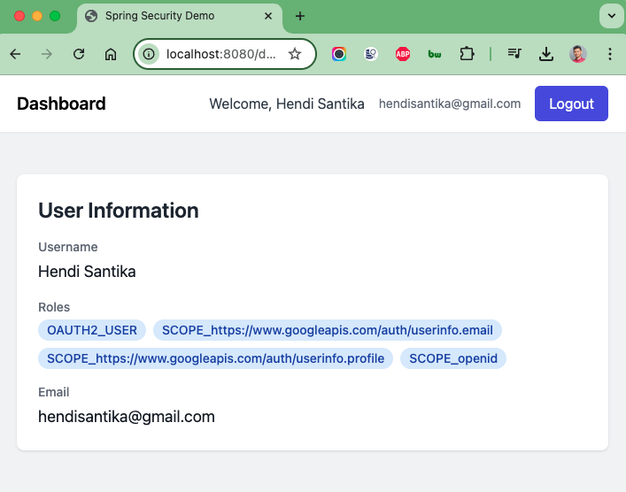

# Spring Boot OAuth2 Login Demo

[](https://github.com/hendisantika/spring-boot-oauth2-jte-demo/actions/workflows/maven.yml)


[](.github/dependabot.yml)

This project demonstrates how to implement OAuth2 authentication in a Spring Boot application using custom login pages
with JTE (Java Template Engine) and Tailwind CSS. It includes both traditional form login and OAuth2 login with Google
and GitHub.

## Features

- Custom login page using JTE and Tailwind CSS
- Traditional username/password authentication
- OAuth2 authentication with Google and GitHub
- Protected dashboard page
- User role display
- Secure logout functionality
- CSRF protection

## Tech Stack

| Component            | Version                                        |
|----------------------|------------------------------------------------|
| Java                 | 25 (Temurin)                                   |
| Spring Boot          | 4.1.x                                          |
| Spring Security      | OAuth2 Client + form login                     |
| jte                  | 3.2.x (precompiled via `jte-maven-plugin`)     |
| Build tool           | Maven 3.10.x via Maven Wrapper (`./mvnw`)      |

## Prerequisites

- Java 25 (JDK 25, e.g. [Eclipse Temurin](https://adoptium.net/))
- Maven is optional: the bundled Maven Wrapper (`./mvnw`) downloads Maven 3.10.x automatically
- Google Cloud account (for Google OAuth)
- GitHub account (for GitHub OAuth)

## Quick Start

1. Clone the repository

```bash
git clone https://github.com/hendisantika/spring-boot-oauth2-jte-demo.git
cd spring-boot-oauth2-jte-demo
```

2. Configure OAuth credentials (see OAuth Setup sections below)

3. Set environment variables

```bash
export GOOGLE_CLIENT_ID=your_google_client_id
export GOOGLE_CLIENT_SECRET=your_google_client_secret
export GITHUB_CLIENT_ID=your_github_client_id
export GITHUB_CLIENT_SECRET=your_github_client_secret
```

4. Run the application

```bash
./mvnw clean spring-boot:run
```

5. Visit http://localhost:8080

To build and run the tests:

```bash
./mvnw clean verify
```

## Default User Credentials

The application comes with a default user for testing:

- Username: `admin`
- Password: `admin123`

## Google OAuth2 Setup

1. Go to [Google Cloud Console](https://console.cloud.google.com/)

2. Create a new project or select an existing one

3. Configure the OAuth consent screen:
   - Go to "APIs & Services" > "OAuth consent screen"
   - Choose "External" user type
   - Fill in required information:
      - App name
      - User support email
      - Developer contact information
   - Add scopes: email, profile, openid
   - Add test users if using external user type

4. Create OAuth2 credentials:
   - Go to "APIs & Services" > "Credentials"
   - Click "Create Credentials" > "OAuth client ID"
   - Choose "Web application"
   - Add these URLs:
     ```
     Authorized JavaScript origins:
     http://localhost:8080

     Authorized redirect URIs:
     http://localhost:8080/login/oauth2/code/google
     ```
   - Note your client ID and client secret

## GitHub OAuth Setup

1. Go to [GitHub Developer Settings](https://github.com/settings/developers)

2. Click "New OAuth App"

3. Fill in the application details:
   ```
   Application name: Your App Name
   Homepage URL: http://localhost:8080
   Authorization callback URL: http://localhost:8080/login/oauth2/code/github
   ```

4. Register the application

5. Note your client ID and generate a client secret

## Configuration

Create or update `application.yml`:

```yaml
spring:
   security:
      oauth2:
         client:
            registration:
               google:
                  client-id: ${GOOGLE_CLIENT_ID}
                  client-secret: ${GOOGLE_CLIENT_SECRET}
                  scope:
                     - email
                     - profile
               github:
                  client-id: ${GITHUB_CLIENT_ID}
                  client-secret: ${GITHUB_CLIENT_SECRET}
                  scope:
                     - user:email
                     - read:user

```

## Project Structure

```
src/
  main/
    java/
      id/my/hendisantika/oauth2jtedemo/
        SpringBootOauth2JteDemoApplication.java  # Main class
        config/
          SecurityConfig.java       # Spring Security configuration
        controller/
          LoginController.java      # Login handling
          DashboardController.java  # Dashboard pages
    resources/
      application.yml           # Application configuration
    jte/
      layout/
        default.jte            # Base template
      pages/
        login.jte             # Login page
        dashboard.jte         # Dashboard page
        home.jte              # Home page
```

## Key Dependencies

```xml

<dependencies>
   <!-- Spring Boot Starters -->
   <dependency>
      <groupId>org.springframework.boot</groupId>
      <artifactId>spring-boot-starter-web</artifactId>
   </dependency>
   <dependency>
      <groupId>org.springframework.boot</groupId>
      <artifactId>spring-boot-starter-security</artifactId>
   </dependency>
   <dependency>
      <groupId>org.springframework.boot</groupId>
      <artifactId>spring-boot-starter-oauth2-client</artifactId>
   </dependency>

   <!-- JTE Template Engine -->
   <dependency>
      <groupId>gg.jte</groupId>
      <artifactId>jte</artifactId>
      <version>3.2.5</version>
   </dependency>
   <dependency>
      <groupId>gg.jte</groupId>
      <artifactId>jte-spring-boot-starter-3</artifactId>
      <version>3.2.5</version>
   </dependency>
</dependencies>
```

## Continuous Integration

GitHub Actions ([`.github/workflows/maven.yml`](.github/workflows/maven.yml)) runs on every push and pull request to `main`:

- Sets up JDK 25 (Temurin) with Maven dependency caching
- Builds and tests the project with `./mvnw -B verify`
- Submits the Maven dependency graph to GitHub (push to `main` only) to power Dependabot alerts
- Cancels outdated runs for the same branch via `concurrency`

## Dependency Updates (Dependabot)

[`.github/dependabot.yml`](.github/dependabot.yml) keeps dependencies up to date:

- **Maven** - checked daily at 05:00 (Asia/Jakarta), PR prefix `chore(deps)`
  - Grouped updates: `spring-boot` (Spring Boot & Spring Security), `jte`, `maven-plugins`, `test-dependencies`
- **GitHub Actions** - checked weekly (Monday 05:00 Asia/Jakarta), all actions grouped in one PR, prefix `ci(deps)`
- PRs are labeled (`dependencies`, `java` / `github_actions`) and assigned automatically

## Troubleshooting

### OAuth2 Issues

1. Redirect URI Mismatch
   - Verify the exact URIs in your OAuth provider settings
   - For Google: `http://localhost:8080/login/oauth2/code/google`
   - For GitHub: `http://localhost:8080/login/oauth2/code/github`
   - No trailing slashes
   - Correct protocol (http/https)
   - Correct port number

2. Authentication Errors
   - Clear browser cookies and cache
   - Check environment variables are set correctly
   - Verify OAuth provider console settings
   - Check application logs for detailed error messages

### Common Issues

1. Login Page Not Loading
   - Verify JTE configuration
   - Check template paths
   - Clear browser cache

2. Authentication Not Working
   - Verify default user credentials
   - Check OAuth configuration
   - Ensure CSRF token is present in forms

## Security Considerations

1. Production Deployment
   - Use HTTPS
   - Update OAuth redirect URIs for production domain
   - Secure client secrets
   - Enable CSRF protection
   - Consider session management settings

2. OAuth Provider Setup
   - Restrict OAuth scopes to minimum required
   - Verify redirect URIs
   - Protect client secrets
   - Use environment variables

### Image Screenshots

Welcome Page



Login Page



Dashboard Page



GitHub OAuth2 Login Page



Dashboard Page 2



Google OAuth2 Login Page



Dashboard Page 3




